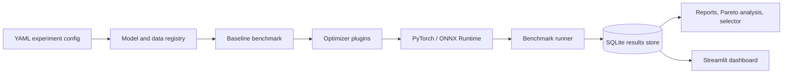

# Neural Network Optimization & Benchmarking Framework

## Abstract

This project implements a config-driven Python framework for applying model optimizations and comparing accuracy, latency, throughput, serialized model size, parameter count, memory, and optional FLOPs. It supplies image and text model registries, PyTorch and ONNX Runtime paths, a SQLite results store, Pareto analysis, a CLI, a dashboard, and a constraint-based selector.

## Objectives

- Apply several optimizations through a common, copy-safe plugin interface.
- Use a consistent seeded evaluation and timing protocol.
- Store model, optimizer, backend, hardware, source revision, and metrics for each run.
- Compare quality, latency, and size with Pareto analysis and constraint filtering.
- Provide a runnable offline demo and CPU/CUDA container recipes.

## Architecture



## Methodology

The `BenchmarkRunner` evaluates batches in inference mode, warms up the first batch, then reports repeated p50/p95/p99 and mean latency plus throughput. It computes classification accuracy and macro/weighted F1. Model state dictionaries are serialized to measure size; parameter counts and process/GPU memory are recorded. Optional batch-size sweeps use the same input data loader. Results include host details, Python and PyTorch versions, timestamp, Git commit, and a stable config hash.

Optimizer plugins include dynamic and static INT8 quantization, quantization-aware training, FP16 conversion, global unstructured and structured channel pruning, `torch.compile`, and knowledge distillation. Plugins clone their input before modification. ONNX exports use a dynamic batch axis, are checked with `onnx.checker`, and can be benchmarked through ONNX Runtime's selectable execution provider and graph optimization level.

## Verification

The repository includes unit and integration tests for registry shapes, reproducibility, metric calculations, optimizer copy-safety and pipeline hand-offs, ONNX parity, SQLite round-trips, Pareto filtering, CLI behavior, dashboard rendering, and recommendations. The suite contains 43 passing tests and measured 85.11% statement coverage on the local Python 3.13 environment. CI enforces at least 80% coverage and runs an offline synthetic experiment on each push and pull request. The CPU Docker image built successfully, ran the synthetic demo, and the Compose dashboard returned a healthy HTTP response.

## Demo results

The included `demo.yaml` runs MobileNetV2 on synthetic CIFAR-shaped input and compares the baseline with 25% magnitude pruning. Because the inputs and labels are synthetic and the model is not trained on CIFAR-10, these measurements verify the pipeline only; they are not evidence of a real accuracy or speed improvement. Run the demo and generate current machine-specific results with:

```powershell
nnbench run experiment=demo --synthetic
nnbench report --out reports
```

One recorded smoke run used Windows 11, Python 3.13.7, PyTorch 2.12 CPU, and eight generated samples. The measured baseline had 0.125 accuracy, 4.15 ms mean latency, and 9.17 MB serialized size. The 25% unstructured-pruned model had 0.125 accuracy, 5.02 ms mean latency, and 9.17 MB size. This result illustrates the expected limitation of storing zeros in dense tensors; it does not show a performance benefit. Timing used only five repetitions and is illustrative, not a reliable benchmark.

## Limitations and next steps

- Baseline training scripts and pretrained loaders are provided, but trained checkpoints are generated locally and are not committed.
- Real CIFAR-10 and SST-2 runs require dataset downloads; pretrained models require model downloads.
- CPU timing is environment-dependent. GPU results require the relevant PyTorch build and CUDA provider.
- PyTorch currently deprecates the `torch.ao.quantization` APIs used by the INT8 plugins, and the legacy ONNX exporter also emits deprecation warnings; both need migration as upstream APIs evolve.
- Structured pruning applies masks and materializes zeros. It does not rebuild smaller dense tensor dimensions, so storage and latency may not improve on ordinary CPU kernels.
- Energy measurement and edge-specific runtimes remain outside this implementation.

## Conclusion

The repository provides a complete, reproducible software path from YAML configuration through model optimization, benchmarking, storage, analysis, visualization, and recommendation. The offline demo and test suite make the hand-offs verifiable without external data; meaningful model-quality conclusions require trained or pretrained checkpoints and real datasets.
